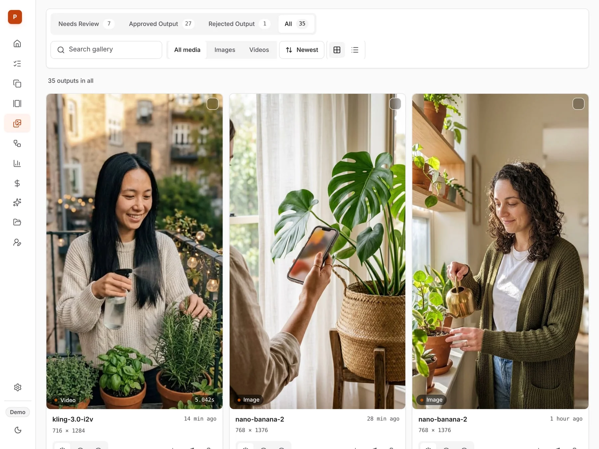

# PostForge

A self-hosted pipeline I built to make AI marketing content for my iOS apps. It generates images and video, packages them into slideshows and UGC-style clips, queues them for review and publishing, and tracks what each one cost and how it performed.

**Live demo:** [postforge-demo-production.up.railway.app](https://postforge-demo-production.up.railway.app) (sample content for a fictional brand; generation and uploads are turned off)



## Built with

- **App:** Next.js 16 (App Router), React 19, TypeScript, Tailwind CSS 4
- **Data:** PostgreSQL, Prisma 7
- **AI:** fal.ai for image and video models, Ollama for text (stories, prompt improvement)
- **Media:** sharp, satori, FFmpeg
- **Storage:** Postgres-backed by default, S3-compatible optional
- **Deploy:** Railway
- **CI:** GitHub Actions (tests, typecheck, lint, production build, boot smoke test)

## Features

- **Generate:** images and video across a registry of models, run through an async job queue (queued → processing → completed → failed)
- **Gallery and collections:** preview, review, download and organise every output
- **Slideshow studio:** generate a story, edit slide by slide, generate an image per slide, reorder, export
- **UGC clone studio:** reference images, source clips, trimming, download
- **Characters:** a reusable character library and builder
- **Automations:** templates with scheduling; publishing is always approval-gated
- **Performance:** metrics from connected TikTok, Instagram and YouTube accounts, or a CSV import
- **Costs:** every model call is logged with its price, so spend is visible per job
- **REST API:** the dashboard and my own AI agent drive the same endpoints

## How I built it

PostForge started because I was paying middleman platforms to call the same AI models I could call directly. It is a single Next.js app: the UI and the API are route handlers in one codebase, with Postgres underneath.

A few decisions shaped it:

- **One connection system.** TikTok, Instagram and YouTube share one server-owned OAuth connection. Settings controls it, Performance reads from it, Automations publishes through it. Tokens never reach the browser.
- **No fake data.** A missing credential or a failed sync stays visibly unavailable. Unavailable metrics are `null`, never zero.
- **A demo that cannot leak.** The public demo is the same code built with a demo flag against its own database. Mutating routes are an allowlist, so a new route is closed in the demo until it is explicitly opened. The database is wiped and re-seeded on a timer, and the app refuses to boot in demo mode against a database holding real content.
- **A gate before merge.** `pnpm kode:check` runs the test suite, module-size and design-token checks, typecheck, lint, a production build and a boot smoke test. Pull requests run it in CI.

## What I learned

- Designing long-running work: job states, polling a provider, and recovering cleanly from failures.
- OAuth across three providers with different scopes and token lifetimes, behind one model.
- Making a single-user tool safe to show publicly without building full authentication.
- Treating cost as a feature. Logging spend per call changed which models I reached for.

## What I'd improve

- Authentication and multi-user workspaces.
- Move background workers out of the web process into their own service.
- More publishing destinations.

## Run it locally

Needs Node.js, pnpm and Docker (for Postgres).

```bash
docker compose up -d                 # Postgres 16 on :5432
cp .env.example .env                 # set DATABASE_URL, add FAL_KEY to generate media
pnpm install
pnpm exec prisma migrate deploy
pnpm dev                             # http://localhost:3000
```

The dashboard, characters, collections, slideshow drafts and automation drafts work without any API keys. Generation needs `FAL_KEY`; publishing and sync need provider credentials.

```bash
pnpm test         # test suite
pnpm kode:check   # full gate: tests, typecheck, lint, build, smoke
```

More detail: [`docs/demo-workspace.md`](docs/demo-workspace.md), [`PRODUCT.md`](PRODUCT.md), [`DESIGN.md`](DESIGN.md).
